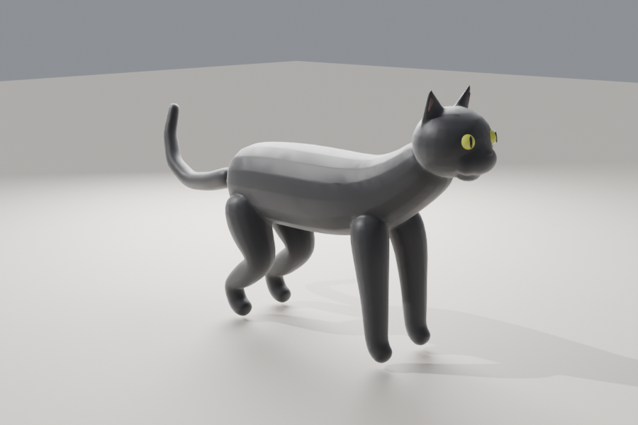

# Draho

A mobile iPhone game about **Drahomil**, a black cat and mouse bounty hunter.
The game uses Unity.



- [Game Design Document](docs/GDD.md)
- [Version 1 Technical Plan](docs/V1_PLAN.md)
- [Asset Shortlist](docs/ASSETS.md) (on hold: we use our own placeholder cat for now)

## Current state: playground

The cat walks, runs and idles on a 20 × 20 m floor in empty space. If the cat
walks off the edge, it falls. After 10 m, it comes back at the start.

## Open the project

1. Clone the repository. (Git LFS is prepared in `.gitattributes`, but it is off for now.)
2. Install **Unity 6.3 LTS** with **iOS Build Support** from Unity Hub.
3. In Unity Hub, click **Add → Add project from disk** and select the `Draho/` folder in this repository.
4. Unity asks *"enable the new Input System backends?"*. Click **Yes**. The editor restarts.
5. In the menu bar, click **Draho → Build Playground Scene**. The script creates the URP settings, the
   materials, the animator, the cat prefab and `Assets/_Draho/Scenes/Playground.unity`.
6. Press **Play**.
7. Commit the files that Unity made: `ProjectSettings/`, `Packages/packages-lock.json`,
   all `.meta` files, and the generated assets.

| Control | Editor | iPhone |
|---|---|---|
| Move | WASD / arrow keys | Left thumb (floating joystick) |
| Run | Hold Shift | Push the joystick to the edge |
| Orbit the camera | Drag with the right mouse button | Swipe with the right thumb |

## Rebuild the cat model

The cat is made by code: [`Tools/Blender/build_drahomil.py`](Tools/Blender/build_drahomil.py).

```bash
pip install bpy            # Blender as a Python module (Python 3.13 for bpy 5.x)
python Tools/Blender/build_drahomil.py -- \
  --out Draho/Assets/_Draho/Art/Cat/Drahomil.fbx --renders /tmp/cat_renders
```

The script checks that the nose and the eyes touch the face. It stops with an
error if a part floats.
