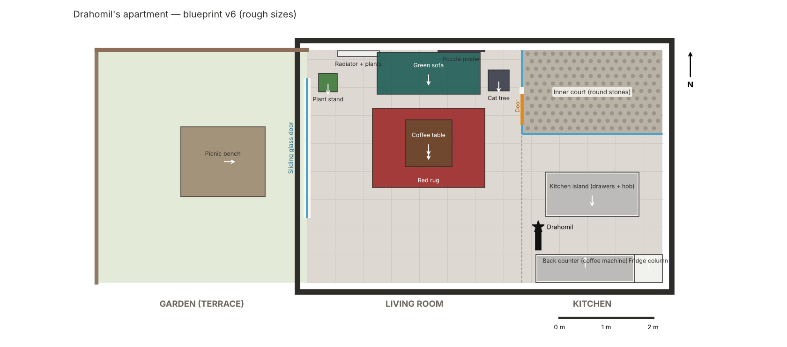

# Level 1: Drahomil's apartment

The first real level is the owner's own apartment: **kitchen → living room → sliding glass door → garden**.
We make a blueprint first. We place and colour the models only after the blueprint is correct.

- **Source of truth:** [`Draho/Assets/_Draho/Levels/Apartment/apartment_layout.json`](../Draho/Assets/_Draho/Levels/Apartment/apartment_layout.json).
  All sizes are in metres. Each prop names the Kenney model that will stand in for it.
- **Redraw the image:** `python Tools/Level/render_blueprint.py Draho/Assets/_Draho/Levels/Apartment/apartment_layout.json docs/images/apartment_blueprint.png`
- **Scale:** the cat is about 0.45 m long. To a cat, the coffee table is a high platform and the sofa is a climb.

## What we saw in the photos and the video

| Area | Details |
|---|---|
| Floor | Large dark-grey tiles (about 60 × 60 cm) everywhere inside. |
| Kitchen | Island with white handle-less drawers, dark-grey top, black induction hob. A back counter with a coffee machine in front of a wood panel wall. |
| Living room | Teal velvet 3-seat sofa against the far wall. Radiator with plants on the left. Wooden square coffee table on a red patterned rug. Cat tree (grey, sisal post) to the right of the sofa. Puzzle poster above the sofa. |
| Inner court | Open-air court with round stones, 1.8 m × 3 m, same width as the kitchen (3 m). North wall = living room north wall, east side = kitchen east wall. Drahomil enters through the west glass door, which is open a crack, next to the cat tree. Its north and east sides are the outer walls of the house; wall-high glass on the south and west sides. |
| Garden side | Floor-to-ceiling sliding glass door. Outside: terrace tiles, a wooden picnic bench, a wooden fence and a brick wall. |
| Cat ideas | Open drawers to hide in (video), the cat tree, the radiator shelf with plants, the sofa back. |

The photos are **not** in the repository, because they show people. Only the blueprint is public.

## Open questions (measure with a phone app or a tape)

1. Total size of the open room (length kitchen → glass door, and width).
2. Is the glass door on the end wall (as drawn) or on a side wall?
3. Size and position of the kitchen island, and which side the drawers face.
4. Where are the front door, the hallway and the stairs (if any)?
5. Size of the garden and where the fence and the brick wall are.
