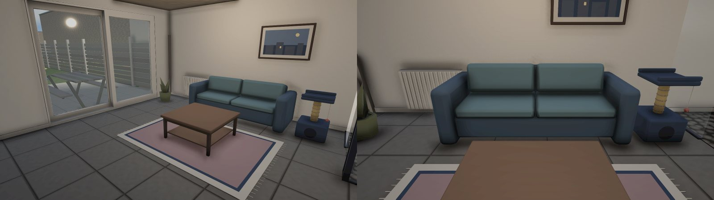

# Apartment graphics: what is in the flat, how good it looks, and the plan

November 2026. The owner asked how the things inside the apartment (level 1) hold up visually, and why the flat looks
rectangular and flatly lit. This page has the audit, what was changed, and what comes next. The art direction stays
[ART_STYLE.md](ART_STYLE.md) (cozy low-poly at blue hour): "better graphics" here means more shape, better light and
cleaner details in that style, not photorealism, which would clash with the cat, the animals and the town.

## 1. Inventory (measured in Unity)

Everything inside the flat's walls (x 0..7.6, z 0..5), from the built `Apartment.unity`, before this round:

| Object | How it was made | Triangles | Material | Collider |
|---|---|---|---|---|
| Sofa | Kenney `loungeSofa`, stretched to 2.2 × 0.9 × 0.85 m | 128 | one flat colour | one box 0.85 m high (the cat sat on air above the seat) |
| Coffee table | Kenney `tableCoffeeSquare` | 124 | one flat colour | one box (no way under it) |
| Rug | Kenney `rugRectangle` | 28 | flat colour | none |
| Radiator | one code box | 12 | flat colour | box |
| Poster | one code box | 12 | flat colour | box |
| Cat tree | three code primitives | 104 | two flat colours | box |
| TV and stand | three code boxes | 36 | flat colours | box |
| Kitchen island, counter, fridge | Kenney kitchen modules | 1,202 / 724 / 436 | flat colours | boxes |
| Walls | code boxes, no skirting, no trim | 12–24 each | flat colour | boxes |
| Front door | a 3 cm board 11 cm in front of the wall | 12 | flat colour | none |
| Drahomil (for scale) | Blender | 44,292 (with the fur layers) | palette + 2 textures | CharacterController |

Light: a sun, a Trilight ambient, a warm point light in the living room and in the kitchen (no shadows), the cat's
fill and rim lights. **No lightmaps, no light probes, no reflection probes, no ambient occlusion.** Only the court
pebbles have a texture and a normal map.

## 2. Why it looked rectangular and flat

1. **Boxes everywhere.** The furniture was low-detail Kenney blocks or code boxes: sharp, unbevelled edges, no cushions,
   no frames, nothing that catches the light. The whole furnished room had about 3,500 triangles; the cat alone has 44k.
2. **No contact shading.** Without ambient occlusion or baked light, corners, the floor under the sofa and the base of
   each wall are as bright as open floor, so objects seem to float and the room reads as a box.
3. **No trim.** Walls met the floor and the doorways in one hard line: no skirting boards, no door linings.
4. **Interior light at night.** The lamps are weak, short and shadowless: at Night the room is one blue tone (still
   true, see §4).

## 3. Done in this round

| Change | Before | After |
|---|---|---|
| Sofa (Blender, `Tools/Blender/build_apartment_props.py`) | 128-triangle block | 1,232: two seat and two back cushions, padded arms, feet |
| Coffee table | 124 | 1,080: walnut top, square legs, rails, lower shelf (the cat can go under it) |
| Cat tree | 3 primitives | 1,504: base with a round entrance, sisal-wrapped post, platform, dangling toy |
| Radiator | 1 box | 2,060: ribbed panel, grille, brackets, valve |
| Poster | 1 box | 588: walnut frame, mat, a blue-hour town picture |
| Rug | 28, paper thin | 708: border, inner line, field, fringes (walk-over) |
| Sofa collider | one 0.85 m box | mesh-shaped: seat 0.44 m, arms 0.68 m, back 0.78 m |
| Front door | board in front of the wall | a real opening, the leaf set 12 cm into the wall, linings and an architrave |
| Kitchen mouse hole | behind the front door | north kitchen wall (x 6.6) |
| Ambient occlusion | none | URP SSAO (full resolution, interleaved gradient, high blur) |
| Skirting boards | none | 8 cm boards along every full-height wall |
| Noise ring round the cat, squeaky-toy ring | 2–3 cm, bright green/orange | 8–10 mm, muted palette colours, half the opacity |

All furniture uses the shared palette material (one draw call per piece, no new textures) and loads from
`Art/Furniture/<layout id>.fbx`; without the file, the old Kenney model is used.

How it was made: the pieces were modelled live in Blender 5.3 through the Blender MCP, following the `blender-director`
production brief (purpose: hero interior props seen at cat height; platform: mobile WebGL; style: house low-poly;
budget 0.5–2.5k triangles per piece) with the `prop-artist`, `materials`, `collision-proxy` and `unity-export` skills,
and checked with renders in Blender and Unity (`ArtCapture`, new `sofa` and `kitchen` views).

## 4. Next steps (most effect first)

1. **Warm interior light at Evening and Night** (ART_STYLE §7, Phase 2b-1): a floor lamp by the sofa and a pendant over
   the island, made in Blender, with brighter, wider warm lights; at Night the room is now one blue tone.
2. **Light probes and a reflection probe** for the flat: the cat and the furniture pick up the warm lamp light and the
   blue window light instead of the flat Trilight ambient. Cheap on phones.
3. **Baked lightmaps for the flat only** (ART_STYLE §7, Phase 2b-3): soft bounce light and real shadows from the lamps.
   Needs lightmap UVs on the furniture (turn on `generateSecondaryUV` for `Art/Furniture`) and a bake step in the build.
4. **More furniture in Blender**: the TV and its stand, the kitchen island and counter (still Kenney), the fridge, the
   plant, curtains at the sliding door, a bookshelf (the long wall is empty).
5. **Ceiling and walls**: a ceiling light fitting, a cornice, window reveals; a subtle plaster texture or vertex-colour
   gradient on the walls (darker near the floor).
6. **Small life** (ART_STYLE Phase 5): cushions that dent when the cat lies on them, a blanket on the sofa, toys.

Check each step on a phone: the furniture adds about 7k triangles and SSAO costs a full-screen pass (AdaptiveQuality
lowers the render scale when frames are slow).
