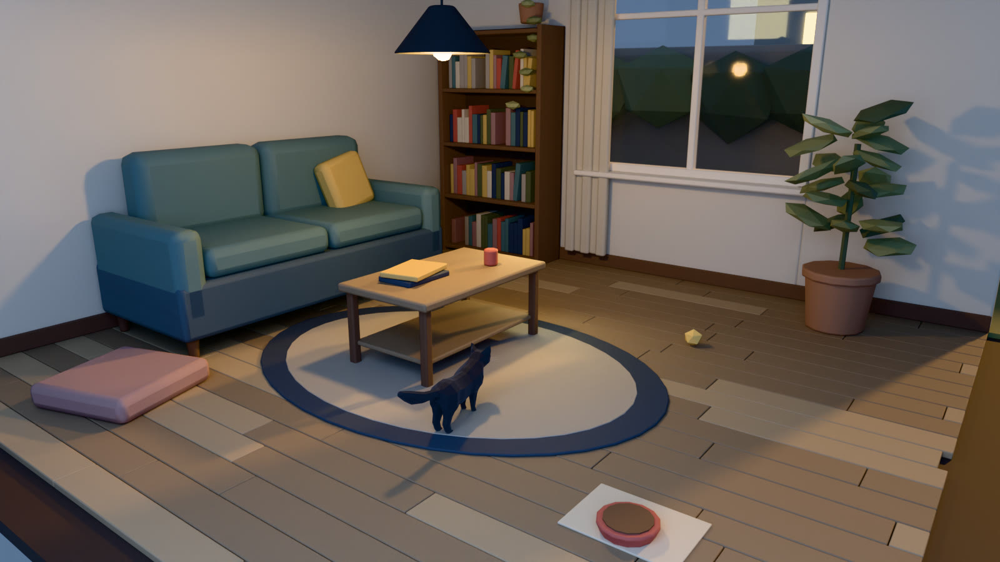
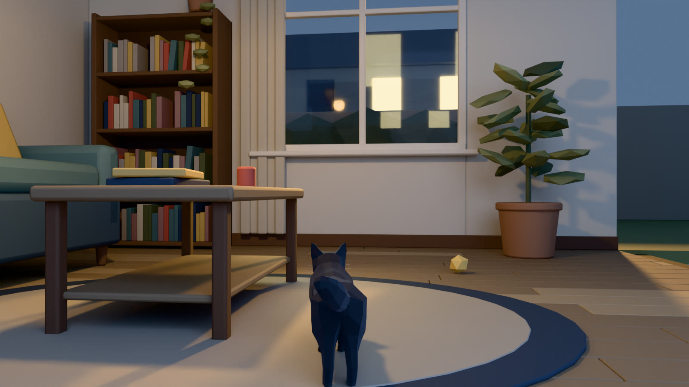
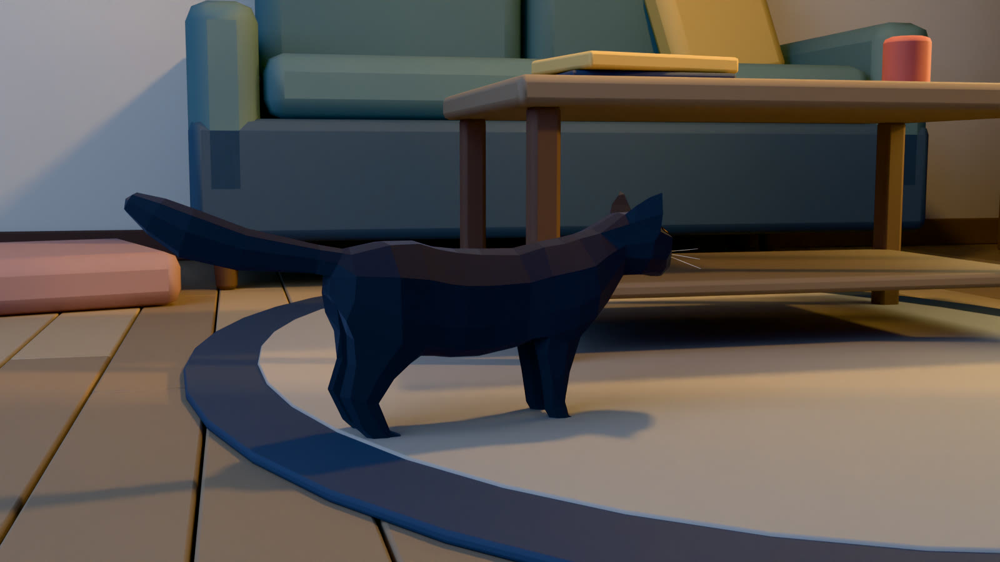
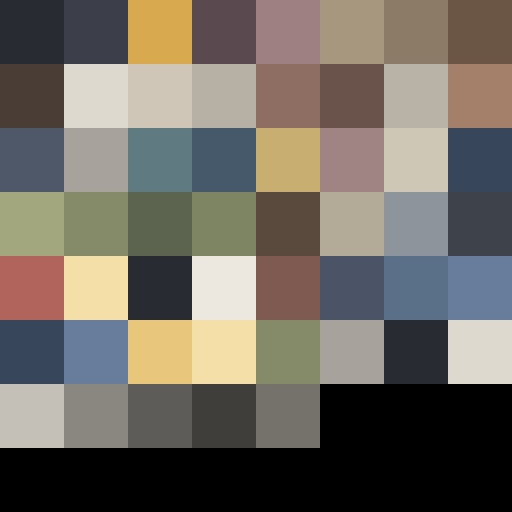
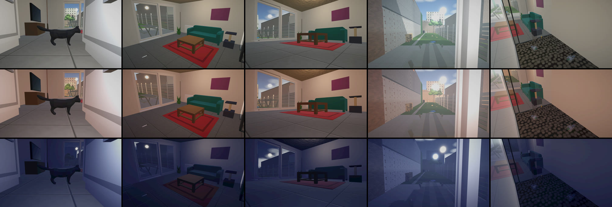
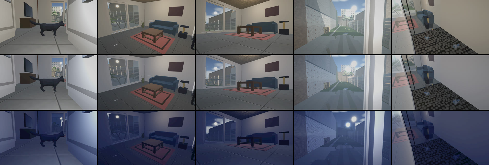

# Draho art style: cozy low-poly at blue hour

Decided: November 2026. Source: the owner's brief, [ART_DIRECTION_BRIEF.md](ART_DIRECTION_BRIEF.md). This page
turns the brief into rules, palette values and Unity settings, and tracks its five phases. It replaces the
"realistic" direction in [GDD §4](GDD.md#4-art-and-audio-direction).

**In one sentence:** a cozy, slightly mysterious low-poly town seen by a cat: cool blue-grey surroundings,
warm yellow light from lamps and windows, muted natural colours, and a black cat that always reads.

Not: horror, photorealism, or a generic bright cartoon.

## The concept frames (target pictures)

Rendered in Blender from [`Tools/Blender/style_lookdev.py`](../Tools/Blender/style_lookdev.py) (path traced, so
they show the target for Unity's baked light). Unity scenes should come close to them.



| Behind the cat (the reference panels' view) | Readability: the black cat against the dark sofa |
|---|---|
|  |  |

The first direction (warm afternoon, saturated) is kept for comparison:
[v0_warm_afternoon.jpg](images/style/v0_warm_afternoon.jpg).

## 1. Palette

One palette for the whole game: [`Art/Palette/DrahoPalette.png`](../Draho/Assets/_Draho/Art/Palette/DrahoPalette.png)
(256 × 256 px, 8 × 8 cells, 53 colours used) with `DrahoPalette.json` (name, hex, UV). The colours are defined
only in [`Tools/Blender/draho_style.py`](../Tools/Blender/draho_style.py) (`PALETTE`); the PNG and JSON are
generated from it.



| Role (brief §1) | Palette names | Main hex |
|---|---|---|
| Blue-grey: ambient, shadows, distance | `deep_blue_grey`, `navy`, `slate`, `roof_slate` | `#38465C` |
| Muted blue: sky, depth, cool surfaces | `muted_blue`, `sky`, `teal`, `teal_dark`, `water` | `#687D9B` |
| Soft yellow: light, windows, things to notice | `soft_yellow`, `pale_yellow`, `cream`, `mustard`, `cat_eye` | `#E8C77D` |
| Muted olive: plants | `olive`, `leaf`, `leaf_light`, `leaf_dark`, `grass` | `#858B69` |
| Warm grey: stone, walls, tiles | `warm_grey`, `stone`, `plaster_shade`, `mortar`, `grey_light`, `grey_mid`, `grey_stone`, `grey_dark`, `grey_deep` | `#A7A29B` |
| Natural brown: wood, doors, props | `oak_light`, `oak`, `walnut`, `walnut_dark`, `soil` | `#8C7B67` |
| Charcoal: Drahomil, dark objects | `charcoal`, `cat_fur`, `black`, `metal_dark` | `#292B32` |
| Warm off-white: plaster, fabric | `off_white`, `plaster`, `linen`, `white` | `#DED9CF` |
| Small muted accents | `rose`, `red`, `terracotta`, `brick` | |

Rules:
- **Yellow means light or "look here".** Lamps, lit windows, the sun patch, toys, mice, doors that open. Large
  surfaces are never yellow.
- No saturated rainbow colours. A new colour must sit next to the others in the palette PNG without jumping out.
- A model has no textures of its own: each face's UVs sit on one palette cell and the model uses the shared
  `DrahoPalette` material (one material per room, few draw calls). Exceptions: glass, emissive bulbs and windows,
  water, the sky, the cat's eye and nose textures.
- Add a colour only at the **end** of `PALETTE` (the position is the cell). Hex values can change freely.

## 2. Shapes

Keep the existing low-poly geometry (brief §3); improve it, don't replace it.

| | Hard surfaces (furniture, walls, houses) | Organic (cat, animals, plants, stones) |
|---|---|---|
| Edges | Bevel outer edges: 1–3 cm furniture, 3–7 cm cushions, 5–10 cm buildings | No bevels |
| Shading | Smooth, weighted normals | Faceted (flat shading) |
| Detail | Big parts only; nothing under 2 cm | Silhouette first: ears, tail, leaf shapes read from 5 m |

`draho_style.soften(obj)` and `draho_style.facet(obj)` apply these rules in Blender.

## 3. Light (the most important part)

The look is made by **cool ambient + warm sources**. The frames use this rig; Unity gets the same values.

| Light | Concept frame (Blender) | Unity (URP) |
|---|---|---|
| Ambient | sky `#687D9B`, strength 1.0 | Trilight: sky `#687D9B`, equator `#7C8291`, ground `#3B3C44` (the *Evening* `SkyMood` preset) |
| Low sun | `#F2B868`, 15–25° above the horizon, soft (3°) | Directional light, soft shadows, intensity about 1.0 |
| Room lamps | warm point light `#FFC978` in each room | Baked point lights (or real-time with a short range, no shadows) |
| Lit windows | emission `#F3DFA7` | Emissive material in the palette's `pale_yellow`; `NightWindows` / `WindowGlow` already switch them |
| Cat separation | small warm rim light from behind the cat | See §4 |
| Fog (outdoors) | – | Linear, colour `#8A97AE`, starts 40 m |
| Tonemapping | *Khronos PBR Neutral* | *Neutral* |

Rules:
- **Never too dark** (brief §2): the cat, platforms, obstacles and interactive things must read in every mood.
  Night is blue, not black.
- Shadows are blue-grey, never neutral grey or black.
- **Post-processing is a finish, not the look** (brief §7): Neutral tonemapping, a little bloom on lamps and
  windows, saturation at or below 0, vignette ≤ 0.2. No global colour filter to fake the palette.

## 4. Drahomil (the black cat)

- Fur `charcoal` / `cat_fur` `#292B32`, rough (0.8) with a low specular, so lamps do not draw a bright stripe
  on the back. A soft cool sheen lights the edges of ears, back and tail.
- **Rim light, not glow:** the game already has a `CatFillLight` that moves with the camera
  (`PlaygroundBuilder.AddPlayerRig`). Phase 2 adds a second short-range light *behind* the cat (pale warm
  `#F3DFA7`, no shadows) so the outline separates from dark backgrounds. No custom shader is needed.
- **Floors where the cat plays are lighter than the cat** (the warm-grey rug in the frames). A large dark
  floor surface needs a light border or a light patch near it. The concept frames showed this: on a deep
  blue rug, the cat disappeared.
- Amber eyes stay the brightest part of the cat; `EyeShine` handles the night.

## 5. Budgets (mobile WebGL and iPhone)

| Asset | Triangles | Textures |
|---|---|---|
| Drahomil | 8–15k (now 2.3k) | the palette + eye and nose textures (256 px) |
| Other animals | 3–6k | palette only |
| Furniture, props | 0.2–2k | palette only |
| A building | 0.5–3k | palette only |
| Whole view | under 150k triangles, under 300 draw calls | |

## 6. Phase 1: audit (November 2026)

| Area | What the project does now | Fit with the brief |
|---|---|---|
| Pipeline | URP 17.3, Unity 6000.3.26f1. `PlaygroundBuilder.EnsureUrp`: MSAA 2×, HDR, soft shadows, 2048 shadow map, 10 m, 2 cascades, FSR upscaling, `AdaptiveQuality` on the camera | Good. Keep it |
| Scenes | Built by code (**Draho → Build Scenes**): `ApartmentBuilder` (about 5000 lines: apartment, garden, courtyard, town) and `PlaygroundBuilder`. No hand-made prefabs | All changes go into the builders, so they are reversible in git |
| Materials | All through `PlaygroundBuilder.LitMaterial` (URP/Lit). Colours from code and from about 66 hex values in `apartment_layout.json`. 21 code-drawn textures with normal maps. Kenney furniture is recoloured by material name (`ApartmentBuilder.Recolor`) | One place to put the palette: map each requested colour to the palette there |
| Custom shaders | `Draho/NightSky`, `Clouds`, `Rainbow`, `Bolt`, `Meteor`, `WindFoliage` | `WindFoliage` already moves leaves (brief §5) |
| Ambient and sky | Trilight ambient (warm afternoon values), procedural skybox, linear fog 90–170 m | Retune |
| Time of day | `SkyMood`: Day, Evening, Night, Storm, Dawn presets (sun, ambient, fog, sky tint, cat fill light), blended at run time; set by `StoryDirector`, `DayCycle`, `Storm`, `MorningMist` | The blue-hour look = new values for these presets, not a new system |
| Post-processing | One global Volume (`PostProcess.asset`): Neutral tonemapping, bloom 0.35, contrast +8, **saturation +6**, post exposure +0.15, vignette 0.22 | Lower the saturation, keep the rest small |
| Baked light | None: no lightmaps, no light probes, no reflection probes. All lights real-time | Biggest open quality step (Phase 2b) |
| Cat readability | `CatFillLight` (point light on the camera, 1.6 m range), `EyeShine` | Add a back light (§4) |
| Life | `WindFoliage`, `Moth`, `GlowWorms`, `Swifts`, `ChimneySmoke`, `NightWindows`, `WindowGlow`, `CloudShadows`, `SunBeam` and more | Phase 5 builds on these |

## 7. Phase plan

- [x] **Phase 1, audit:** §6.
- [x] **Concept image** of the apartment in this direction (the frames above).
- [x] **Phase 2a, apartment prototype (palette, light, Volume, cat):**
  1. **Palette:** [`Editor/PaletteMap.cs`](../Draho/Assets/_Draho/Editor/PaletteMap.cs) maps every colour that
     `PlaygroundBuilder.LitMaterial` gets (so also `ApartmentBuilder.Mat` and the Kenney `Recolor`) to the
     nearest palette colour in OKLab, with hue and chroma weighted 3× (a grey must not turn olive). It keeps
     glass, the cat's eye and nose, and white-tinted textures. `PaletteMap.Enabled = false` turns it off.
  2. **Light:** `SkyMood` Evening is now blue hour (cool `#687D9B` ambient, warm low sun, blue-grey fog);
     Night is lighter and less grey (saturation −20 instead of −35); Dawn is cooler; the Day sky is muted.
  3. **Volume:** saturation +6 → −5, contrast 8 → 5, bloom 0.35 → 0.3, vignette 0.22 → 0.18.
  4. **Cat:** charcoal rough fur (smoothness 0.35 → 0.2), and a `CatRimLight` behind the cat on **rendering
     layer 1**, so it lights only Drahomil (no pool of light on the floor). URP "Use Rendering Layers" is on.

  Before (top) and after (bottom). Rows: Day, Evening, Night. Columns: the cat, living room, living room at
  cat height, garden, inner court. Made with `ArtCapture` (§8), Unity 6000.6.8f1, same camera positions.

  
  

- [ ] **Phase 2b, apartment, still open:**
  1. Warm interior light at Evening and Night: a lamp in the living room and the kitchen (the layout has no
     ceiling lamp), and check that `NightLamp` / `WindowGlow` come on (the edit-mode capture cannot show them).
  2. The sky seen through the windows at Evening still looks like day (bright, with a sun disc).
  3. Baked lightmaps and light probes for the apartment.
  4. Check on a phone: frame time with the extra rim light and rendering layers.
- [ ] **Phase 3, review:** the owner reviews the pictures above, and the web build on a phone.
- [ ] **Phase 4:** courtyard and garden.
- [ ] **Phase 5:** curtains, flowers, insects round lamps, small objects that react to the cat.

## 8. Tools

| Step | Tool |
|---|---|
| Palette, styling rules, look-dev light, GPU render | [`Tools/Blender/draho_style.py`](../Tools/Blender/draho_style.py) |
| Concept frames and the palette files | [`Tools/Blender/style_lookdev.py`](../Tools/Blender/style_lookdev.py) |
| The cat | [`Tools/Blender/convert_lowpoly_cat.py`](../Tools/Blender/convert_lowpoly_cat.py) |
| Before/after pictures in Unity | [`Editor/ArtCapture.cs`](../Draho/Assets/_Draho/Editor/ArtCapture.cs) |

Run them with a local Blender 5.x. On Windows, give **absolute paths** (Blender resolves relative output paths
in its own way):

```powershell
& "C:\Program Files\Blender Foundation\Blender 5.0\blender.exe" -b --factory-startup `
  --python Tools/Blender/style_lookdev.py -- `
  --cat "$PWD/Draho/Assets/_Draho/Art/Cat/Drahomil.fbx" --out "$PWD/docs/images/style/raw" `
  --palette "$PWD/Draho/Assets/_Draho/Art/Palette/DrahoPalette.png" --samples 128
```

With an RTX 5080 (OptiX) the three frames take about 2.5 minutes. The Kenney models are ASCII FBX, which
Blender cannot import; Unity recolours them (Phase 2, step 1).

**Pictures from Unity:** run `CiBuild.Prepare` once, then `ArtCapture.Run`. It builds the scenes and renders
5 views × 3 moods:

```powershell
& "D:\Unity\Hub\Editor\6000.6.8f1\Editor\Unity.exe" -batchmode -projectPath "$PWD\Draho" `
  -executeMethod Draho.EditorTools.ArtCapture.Run -captureOut "D:\Code\Draho-work\captures\after" -quit
```

The palette PNG and JSON can be remade without rendering: `draho_style.save_palette(path)` in Blender.

**Unity version:** the project and CI use **6000.3.26f1**. Open it with that version. A newer editor (6000.6)
upgrades the project files and the CI build would no longer match.
