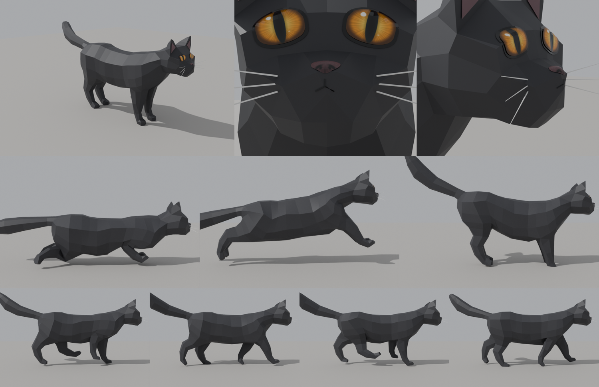

# Drahomil

**Drahomil** ("Draho" for short) is the hero of the game. He is also a real cat.

| | |
|---|---|
| **Species** | House cat, all black, yellow-green eyes |
| **Born** | May 2025 |
| **Home** | An apartment with a garden in Flanders, Belgium |
| **Best friend** | [Zlatenka](zlatenka.md), a leopard tortoise |
| **Frenemy** | [Hrozna](hrozna.md), a Cardigan corgi |
| **Enemy** | [Fatsocat](fatsocat.md), a big white cat |
| **Job in the game** | Mouse bounty hunter |

## His real story

Drahomil was born in May 2025. In his first weeks he lived **under the green couch**. He came out only when
the house was quiet. Slowly, his owners tamed him with patience, food and a lot of time on the floor.

Today he is a **spoiled cat**. He has the best spots in the house, he decides when it is time to eat, and he
patrols his garden like he owns it. In his own mind, he does.

## In the game

In Draho, Drahomil turns his patrols into a job: people hire him to hunt mice. The game shows the world from
his height. A table is a high platform, and the gap under a sofa is a hiding place, just like the green couch
where he grew up.

## His name

Drahomil is a Slavic name. It comes from words for "dear" and "kind".
