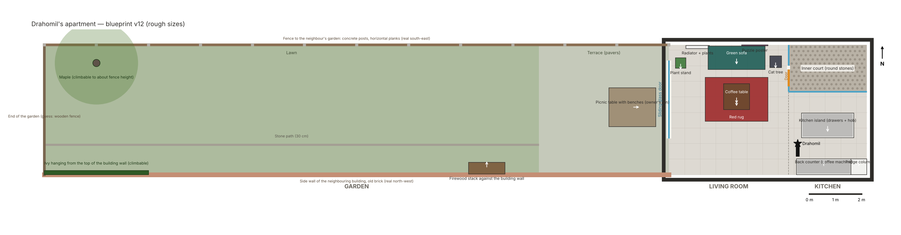

# State of the game

_Last update: 15 October 2026._

Draho is in **early development**. The test build is free, and it changes many times a day. Things can break.

## What you can play today

* **Drahomil's apartment:** the kitchen, the living room, a small inner court and the garden.
* **Movement:** walk, run, jump onto furniture, duck and sneak, stand up on the hind legs.
* **Climbing:** the ivy at the end of the garden and the trunk of the maple tree.
* **The garden:** a terrace with a picnic table, a lawn, a stone path, a maple tree, a brick wall and a wooden fence.
* **The sliding garden door:** wait in front of it and it opens.
* **Blackbirds** on the lawn: sneak up on them. If you are loud, they fly away.
* **A first mouse hunt:** the mouse starts at a hole near the fridge.
* **Light:** afternoon sun, soft shadows and a gradient sky.

## What is not there yet

* The bounty board with jobs and clients
* Other locations outside the home
* Coins, reputation and cosmetics
* Save and load
* Music (cat sounds come first)
* The other characters: [Zlatenka](../characters/zlatenka.md), [Hrozna](../characters/hrozna.md) and [Fatsocat](../characters/fatsocat.md)

## How we test

Each change goes into the web build automatically, about 6 to 10 minutes after it is saved. Sander then plays
it on his phone and reports what feels wrong. Each round of feedback becomes the next change.
See [How Draho is made](../behind-the-game/how-it-is-made.md).
